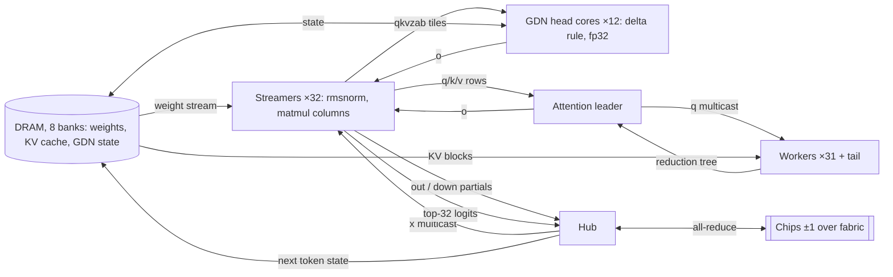

# tt-qwen-resident

Qwen3.6-27B (dense, 64 layers: 48 Gated DeltaNet + 16 full attention) on a Tenstorrent QB2 (4× Blackhole P150).
Decode is 3× faster and TTFT is lower at every prompt length than the tt-metal reference, with better token
accuracy. This came from replacing the op-by-op ttnn execution with a design built for Tensix.

The tt-metal reference is tt-metal's own Qwen3.6-27B implementation (`models/demos/blackhole/qwen36`):
op-by-op ttnn, tensor-parallel over 4 chips. All comparisons below are against it.

| | |
|---|---|
| Decode, batch 1 | 83 tok/s/user (tt-metal: 25.5) |
| Decode, batch 1, MTP speculative decode | 118–125 tok/s/user on chat prompts, served through vLLM |
| TTFT, 511-token prompt | 0.19 s (tt-metal: 0.31 s at 128) |
| Batch 8 | 374 tok/s total, 46.7 tok/s/user (tt-metal: 165 total) |
| Longest context run end to end | 256k |
| Token accuracy, top-1 / top-5 | 99.41 / 100 (tt-metal: 98.63 / 100) |

Accuracy is teacher-forced against the Hugging Face reference, 512 scored tokens, same reference file for both.

## Setup

Needs a QB2 (4× Blackhole P150) and the Hugging Face checkpoint `Qwen/Qwen3.6-27B` in
`~/.cache/huggingface/hub`.

```bash
git clone --recurse-submodules git@github.com:sott0n/tt-qwen-resident.git
cd tt-qwen-resident
./scripts/setup.sh          # applies patches/, builds tt-metal, creates its python env
```

`pip install ttnn` is not enough: the prefill uses a ttnn op change (`patches/`) and kernel APIs newer than the
published wheels. To use an existing tt-metal build of the pinned commit with the patches applied, set
`TT_METAL_HOME` to it before sourcing `scripts/env.sh`.

## How to run

There are three ways, from easiest to most hands-on.

**1. Prebuilt container (no setup needed).** Needs Docker and
[tt-model](https://github.com/tenstorrent/tt-model-manager):

```bash
tt-model serve kyamaguchiTT/qwen3.6-27b-resident-p150x4                 # OpenAI API on port 20000
tt-model serve --profile mtp kyamaguchiTT/qwen3.6-27b-resident-p150x4   # with MTP speculative decode
```

**2. vLLM server from this checkout.** After [Setup](#setup), install vLLM 0.26.0 and
[vllm-tt-plugin](https://github.com/tenstorrent/vllm-tt-plugin) at `3506696` in a separate python environment
(see the plugin's "Environment Setup"). Then start the server:

```bash
source scripts/env.sh
export MESH_DEVICE=P150x4
export EXTRA_MODELS_DIR=$PWD/qwen36_resident/vllm_models   # registers this model with the plugin
<vllm-env>/bin/vllm serve Qwen/Qwen3.6-27B \
  --max-num-seqs 1 --block-size 64 --max-model-len 32768 --async-scheduling --port 8000 \
  --additional-config '{"tt": {"trace_region_size": 134217728, "sample_on_device_mode": "decode_only"}}'
```

For MTP speculative decode, add this before `vllm serve`:

```bash
export TT_MODEL_CLASS_OVERRIDES="TTQwen3_5ForConditionalGeneration=qwen36_resident.generator_vllm:Qwen36ResidentMTPForCausalLM"
```

Send a request once the server prints that it is ready:

```bash
curl localhost:8000/v1/chat/completions -H 'Content-Type: application/json' \
  -d '{"model": "Qwen/Qwen3.6-27B", "messages": [{"role": "user", "content": "Hello"}], "max_tokens": 64}'
```

**3. Without vLLM.** The accuracy test loads the real weights and runs the model end to end. It needs the
reference tokens from tt-metal (`models/tt_transformers/tests/reference_outputs/Qwen3.6-27B.refpt`, or set
`RESIDENT_REFPT`):

```bash
source scripts/env.sh
pytest qwen36_resident/tests/test_resident_accuracy.py::test_resident_accuracy                     # decode
RESIDENT_PREFILL=1 pytest qwen36_resident/tests/test_resident_accuracy.py::test_resident_accuracy  # prefill + decode
```

If a run hangs, reset the cards with `tt-smi -r 0,1,2,3` before the next one.

## Results against the tt-metal reference

Measured on the same host.

| Metric | tt-metal | This work | Ratio |
|---|---|---|---|
| Decode, batch 1, short context | 25.5 tok/s/user | 83 tok/s/user | 3.3× |
| TTFT, 128 tokens | 0.31 s | 0.12 s | 2.6× |
| TTFT, 4k | 0.65 s | 0.63 s | 1.0× |
| TTFT, 8k | 1.24 s | 1.07 s | 1.2× |
| TTFT, 16k | 2.68 s | 2.06 s | 1.3× |
| TTFT, 32k | 6.35 s | 4.50 s | 1.4× |
| TTFT, 128k | 34.4 s | 32.6 s | 1.06× |
| Decode, batch 1, at 32k / 128k | 24.3 / 22.9 tok/s/user | 73.7 / 57.9 tok/s/user | 3.0× / 2.5× |
| Batch 8: total tok/s (tok/s/user) | 165 (20.6) | 374 (46.7) | 2.3× |
| Batch 32: total tok/s (tok/s/user) | 404 (12.6) | 374 (11.7) | 0.93× |
| Token accuracy top-1 / top-5 | 98.63 / 100 | 99.41 / 100 | — |

Rates marked tok/s/user are per user; at batch 1 that is the whole decode rate. Totals are tok/s summed over
the batch. Decode rates include the host's read of every generated token; at batch 1 the device feeds itself
(see [Resident decode](#resident-decode)). TTFT is end to end: prefill, state handoff to the decode model, and
the first decode step. The tt-metal reference's batched runs use 128-token prompts.

## Distance to the floor

The floor is the fastest the hardware allows for the work. Decode is bound by DRAM bandwidth: each batch-1
token reads 5.47 GB of weights per chip, and DRAM delivers about 510 GB/s per chip (512 GB/s spec). Prefill is
bound by compute: 2 FLOPs per weight per token on 24.5 B weights (the embedding and lm_head excluded), plus
causal attention, at 4 × 371 TFLOPS (the sustained matmul rate measured in ttnn).

| Workload | Floor | tt-metal | % of floor | This work | % of floor |
|---|---|---|---|---|---|
| Decode step, batch 1 | 10.7 ms | 38.3 ms | 28% | 12.1 ms | 88% |
| Decode token with host, batch 1 | 10.7 ms | 39.2 ms | 27% | 12.0 ms | 89% |
| Decode step, batch 8 | 11.9 ms | 48.5 ms | 25% | 21.4 ms | 56% |
| Prefill, 8k prompt | 0.27 s | 1.24 s | 22% | 1.07 s | 25% |
| Prefill, 32k prompt | 1.22 s | 6.35 s | 19% | 4.50 s | 27% |

The batch-8 floor adds each user's GDN state read and write (about 75 MB per user per chip). Prefill rows are
end-to-end TTFT; prefill alone is 1.02 s at 8k (27%). The tt-metal reference's batch-1 step is from a profile at tt-metal
`816841ddc93`; its host-included token uses 25.5 tok/s/user measured at `f9304d29843`.

Where the rest goes:

- **Decode, batch 1 (12%).** The weight stream runs at about 490 GB/s, 4% under the DRAM limit. The rest is
  waiting at layer boundaries and the argmax after the lm_head.
- **Decode, batch 8 (44%).** GDN heads and attention handle the users in turn, and the weight ring is smaller
  because the extra users' activations use L1.
- **Prefill (about 73%).** The pipeline needs n + 3 ticks for n chunks, so an 8k prompt (8 chunks, 11 ticks)
  caps at 73% of the work rate. Chunk-1024 ticks are power-throttled to 1000–1250 MHz from 1350 MHz. The GDN
  chunk ops and the gaps between ops take about 18 ms per tick.

These floors are first-order estimates, not measured ceilings. Very short prompts are latency-bound, so the
table leaves them out.

## Design principles

- **Decode time is weight-read time.** At batch 1 each token reads 5.5 GB of weights per chip, so a step
  cannot be faster than DRAM bandwidth allows. The target is that floor: weights stream without stopping, and
  every other piece of work hides under the stream.
- **Lay work out in space, not in time.** Cores get fixed roles for the whole step and run at the same time,
  instead of every core running one op after another. One persistent program per chip means no per-op launch,
  no gap between ops, and no reconfiguration.
- **Keep activations on chip.** Only weights, KV cache and recurrent state live in DRAM. Activations pass core
  to core in L1 over the NOC, with semaphores as the only synchronization.
- **Put communication inside the program.** The cross-chip all-reduce is part of the same program and overlaps
  with weight streaming, instead of being a separate collective op that every core waits for.
- **Choose parallelism per phase.** Decode is bandwidth-bound, so tensor parallelism splits the weight reads
  across chips. Prefill is compute-bound, so pipeline parallelism removes tensor-parallel traffic. A device
  kernel moves the state from one layout to the other.
- **Fit the data to Tensix.** Single-row tiles at batch 1 and one row per user when batched; 32×32 views so one
  SFPU op covers a whole block; readers placed next to their DRAM bank, on both NOCs.
- **Judge by the floor and by the whole model.** Every change is measured against the bandwidth or compute
  floor, and must keep 64-layer token accuracy and bit-repeatable runs. Passing op-level tests is not enough.

## Design compared with the tt-metal reference

Both run the same model with the same weight formats (gate/up bf4, the other projections and down bf8, KV cache
bf8, GDN state fp32) and are scored against the same reference. The execution model is what differs.

| Aspect | tt-metal | This work |
|---|---|---|
| Unit of execution | A graph of ttnn ops, about 4,800 per decode token, replayed from a trace. Each op is its own program; data goes back to DRAM or L1 between ops. | One persistent program per chip for the whole decode step (64 layers + lm_head). Activations stay in L1 from layer to layer. |
| Core allocation | Every op picks its own grid; each core does one op at a time. | Fixed roles for the whole step: 32 weight streamers, GDN head cores, an attention leader with 31 workers and a tail core, one all-reduce hub. The roles run at the same time. |
| Weight reads | Per matmul op (DRAM-sharded). About 300 GB/s per chip; reads stop between ops. | One continuous stream of all layers through a 1 MB L1 ring per streamer, on both NOCs. About 490 GB/s per chip; it reads ahead while the other roles work. |
| Decode parallelism | Tensor-parallel over 4 chips. | Tensor-parallel over 4 chips (same split). |
| Cross-chip reduce | ttnn CCL ops (matmul + reduce-scatter, all-gather): 14 to 18 µs each, 258 per token. | A hand-written fabric all-reduce on the hub core, in the same program: 3.75 µs per vector; the hub sums the 4 chips and multicasts x to the streamers. |
| GDN recurrence (decode) | About 65 ttnn ops per layer. | One core per value head runs the whole delta-rule step in fp32 and writes the state back in place. |
| Decode attention | Paged KV cache; ttnn SDPA decode op. | KV cache sharded over the DRAM banks, read by 31 workers in blocks with an online softmax; partials meet in a reduction tree. The new k/v row is written in the same step. |
| Prefill parallelism | Tensor-parallel over 4 chips, chunks of 2,048 tokens. All-gather + matmul (46% of a chunk) and reduce-scatter carry about 4 GB per chunk per chip over Ethernet. | Pipeline-parallel: 16 whole layers per chip; only the chunk's activations move chip to chip. Chunks of 128 to 1,024 tokens, picked per prompt; each tick is traced once. |
| Prefill to decode | Same tensor-parallel model and cache layout for both phases. | Two layouts (pipeline for prefill, tensor-parallel for decode); a device kernel moves KV, GDN state and conv history between them. |
| Batching | Batch dimension in every op; paged KV and batched GDN state; batch 8 and 32 in one trace. | Up to 8 users share one weight stream, as rows of the activation tiles; GDN and attention cores take the users in turn. Larger batches run as sub-batches of 8. |
| Main limit | Op count and op gaps (decode); Ethernet traffic of tensor-parallel prefill. | DRAM bandwidth for weights (decode, 88% of the hardware floor); prefill attention at long context; L1 size for batches above 8. |

tt-metal facts are from `models/demos/blackhole/qwen36` at tt-metal `f9304d29843` (op and CCL counts from a
profile of commit `816841ddc93`).

## Starting point: where the time went

A roofline study of the tt-metal reference set the direction. At 128 tokens of context, decode took 38.3 ms per token
(26.1 tok/s/user, batch 1):

| Part of a decode step | Time | What it is |
|---|---|---|
| Matmuls | 18.1 ms | 301 GB/s of weight reads; 84% of the 360 GB/s the ttnn matmul reaches |
| Other ops | 10.3 ms | 4,312 small ops (reshapes, copies, slices, eltwise) |
| Gaps between ops | 4.9 ms | about 1 µs per op even inside a trace |
| All-reduces | 3.9 ms | 258 CCL ops at 14–18 µs each |
| Host | 1.1 ms | |

About 4,800 ops ran per token, only 7 of them per layer were matmuls. Prefill reached about 20% of the 371
TFLOPS the matmul engine sustains, and tensor-parallel prefill moved about 4 GB per chunk per chip over Ethernet,
more than its compute floor. The gap was in the software structure, not in the model's math.

First attempt, fusing ops inside ttnn: six fused ttnn ops (GDN decode step, attention decode prep, causal
conv1d for decode and prefill, gated norm, GDN gates) took batch-1 decode from 26.2 to 37.1 tok/s/user and 8k
TTFT from 1.31 to 1.19 s, with ops per token down from 4,777 to 1,305. Every remaining step was a small local
fusion with a hard ceiling, so the work moved to a new execution model.

## Resident decode

One persistent program per chip runs a whole decode step: 64 layers and the lm_head, tensor-parallel over 4
chips. Nothing is launched per op. Each group of cores has one fixed job. Weights, KV cache and GDN state stay
in DRAM; what is resident is the program and the role of each core.

Core map of one chip at batch 1 (logical coordinates; all 4 chips use the same map):

```
        x=0   1   2   3   4   5   6   7   8   9  10  11  12
      ┌───┬───┬───┬───┬───┬───┬───┬───┬───┬───┬───┬───┬───┐
 y=0  │ L │ G │ G │ W │ W │ W │ W │ G │ G │ G │ G │ G │ G │
 y=1  │S1 │S1 │ H │ W │ W │ W │ W │S5 │S5 │ G │ G │ G │ G │
 y=2  │S1 │S1 │ . │ W │ W │ W │ W │S5 │S5 │ . │ . │ . │ . │
 y=3  │S3 │S3 │ . │ W │ W │ W │ W │S7 │S7 │ . │ . │ . │ . │
 y=4  │S3 │S3 │ . │ W │ W │ W │ W │S7 │S7 │ . │ . │ . │ . │
 y=5  │S2 │S2 │ . │ W │ W │ W │ W │S6 │S6 │ . │ . │ . │ . │
 y=6  │S2 │S2 │ . │ W │ W │ W │ W │S6 │S6 │ . │ . │ . │ . │
 y=7  │S0 │S0 │ . │ W │ W │ W │ T │S4 │S4 │ . │ . │ . │ . │
 y=8  │S0 │S0 │ . │ . │ . │ . │ . │S4 │S4 │ . │ . │ . │ . │
 y=9  │ . │ . │ . │ . │ . │ . │ . │ . │ . │ . │ . │ . │ . │
      └───┴───┴───┴───┴───┴───┴───┴───┴───┴───┴───┴───┴───┘
```

| Cores | Role | L1 per core |
|---|---|---|
| `Sn` streamers, 32 (2×2 next to DRAM bank n) | Stream every weight through a 1 MB L1 ring; rmsnorm, projections, conv1d, MLP, lm_head. Reads alternate NOC0 / NOC1. | ~1.07 MB |
| `G` GDN head cores, 12 (48 at batch ≥ 4) | One per local value head: delta-rule recurrence, fp32 state in DRAM, updated in place | ~0.52 MB |
| `L` attention leader, 1 | q norm + RoPE, multicasts q, root of the reduction tree | ~0.35 MB |
| `W` attention workers, 31 | Stream the KV cache in blocks of 8 tiles with an online softmax; fan-in-8 reduction tree | ~0.59 MB |
| `T` attention tail, 1 | k norm + RoPE, writes the new KV row | worker + tail buffers |
| `H` hub, 1 | Fabric all-reduce with the chips ±1, multicasts x back; top-32 merge and sampling; next token state | ~0.1 MB |
| `.` idle, 52 | | |

Placement is computed at load (`model.py`, `streamer_cores` in `common.py`): streamers from the optimal
DRAM-bank-to-worker assignment, the hub at the first free core in their bounding box, the workers as a 4×8
rectangle, then the leader and the head cores from the remaining free cores. L1 figures are sums of the
circular buffers and L1 tensors at batch 1.

One layer of a decode step:



A GDN layer uses the head cores; a full-attention layer (every fourth) uses the leader, workers and tail. Each
layer has two hub all-reduce rounds: after the out projection and after the MLP down projection.

- GDN layer: 222.9 → 164.6 µs once the reader used both NOCs and interleaved the 4 cores of a bank.
- MLP half: 97 µs per layer (503 GB/s).
- Attention layer: 155–160 µs at short context.
- All-reduce: 3.75 µs per [1, 5120] vector, against 14 µs for the ttnn CCL op.

At batch 1 the step also produces the next step's input, so the host is never between two steps. Each
streamer keeps the top 32 of its logits; the hub merges them into the chip's top 32, exchanges that 256-byte
list with every chip over fabric, and every chip draws the same token from the merged list: greedy, or
temperature, top-k (<= 32) and top-p in fixed point (the data movement cores have no FPU), with a random
number hashed from the request's seed and the position. It then writes the next token state to DRAM: the position + 1, the token's embedding
row (from the prefill's table) and the RoPE tiles of the new position (from a table built at load). A token
costs 12.0 ms with the host reading it one step late, against 12.6 ms when the host writes each state. The
fabric semaphores count up from a per-hub launch counter and are never reset inside a step: with no host gap,
a peer can start the next step and count into this chip before this chip's step ends.

## Pipeline-parallel prefill

Prefill is compute-bound. Tensor parallelism would make it communication-bound: every half layer all-reduces
a [chunk, 5120] activation over Ethernet. So prefill splits the model by layers instead. Chip p holds the
full weights of layers 16p to 16p + 15. The prompt is cut into chunks of C tokens, and each chunk passes
through chip 0, 1, 2 and 3 in turn. Only the chunk's [C, 5120] activation moves between chips, sent by a
small fabric kernel (`prefill/kernels/shift.cpp`).

A tick is one step of the pipeline: in tick t, chip p runs its 16 layers on chunk t − p, then passes the
result to chip p + 1 for the next tick. For a prompt of 5 chunks:

```
tick:    0   1   2   3   4   5   6   7
chip0:  c0  c1  c2  c3  c4  --  --  --      layers  0-15
chip1:  --  c0  c1  c2  c3  c4  --  --      layers 16-31
chip2:  --  --  c0  c1  c2  c3  c4  --      layers 32-47
chip3:  --  --  --  c0  c1  c2  c3  c4      layers 48-63
```

n chunks take n + 3 ticks. In the slots marked `--` a chip has no chunk to work on.

All 4 chips run the same program in every tick, so a tick is traced once per chunk size and replayed. The
program is the same, but each chip reads different data:

- **Weights.** Stage layer j is one mesh tensor sharded over the chips, so the same tensor holds layer j on
  chip 0, layer 16 + j on chip 1, and so on (`pp_prefill.py`). This needs the same layer pattern on every
  chip: 16 is a multiple of the attention interval 4, so each chip runs GDN, GDN, GDN, attention four times.
- **Per-tick values.** Positions, RoPE, the KV blocks to write and two flags (`valid` rows, `update`) differ
  per chip and per tick. The host writes them into small control tensors before each tick.
- **Empty slots.** A trace cannot skip work on one chip, so the empty slots still compute and then discard
  the result: with `update = 0` the GDN gates are g = 0 and β = 0, so the delta rule leaves the state
  unchanged; the conv history is not updated; and the KV rows go to scratch blocks. The same mask covers the
  padding rows of the last chunk. Without a trace those chips would sit idle instead; either way the empty
  slots cost the same time, and they cap an 8k prompt (8 chunks, 11 ticks) at 73% of the work rate.

The chunk size (128, 256, 512 or 1024 tokens) is picked per prompt from a timing model. It estimates
(chunks + 3) × tick time, where the measured tick time grows with the prompt's mean context. Small chunks
cut the empty slots on short prompts; large chunks make the matmuls more efficient on long ones. After the
last tick, a device kernel (`handoff.cpp`) moves the KV cache and GDN state into the decode model's
tensor-parallel layout, on chip or over fabric.

| Prompt (tokens) | 127 | 255 | 511 | 1k | 2k | 8k | 16k |
|---|---|---|---|---|---|---|---|
| TTFT, end to end | 0.12 s | 0.14 s | 0.19 s | 0.28 s | 0.39 s | 1.07 s | 2.06 s |

What moved it, beyond pipeline parallelism itself:

- Fused kernels for add + RMSNorm, q/k norm + partial RoPE, conv, GDN gates and SiLU.
- Matmul configs tuned per chunk size.
- A small-chunk matmul that streams bank-major weight copies on both NOCs; gate/up dropped from 210 to 150 µs
  at chunk 128.
- Handoff to the decode model on device, cut from 152 to 15 ms.

Chunk-1024 ticks are power-throttled: the clock drops from 1350 to 1000–1250 MHz at 200–250 W against a 150 W
TDP. Profiles taken without a trace run at full clock and understate the tick.

## Long context

Decode attention streams the KV cache in blocks of 8 position tiles with an online softmax, so worker L1 no
longer grows with the context. Logits PCC against torch is 0.998 at position 131k.

| Prompt (batch 1) | TTFT | Decode | tt-metal TTFT | tt-metal decode |
|---|---|---|---|---|
| 32k | 4.50 s | 73.7 tok/s/user | 6.35 s | 24.3 tok/s/user |
| 64k | 11.3 s | 67.8 tok/s/user | not measured | not measured |
| 128k | 32.6 s | 57.9 tok/s/user | 34.4 s | 22.9 tok/s/user |
| 256k | 107.0 s | 44.9 tok/s/user | not measured | not measured |

At 128k the prefill is nearly level with the tt-metal reference. Prefill attention FLOPs grow with the square of the prompt
and dominate there; this is the next prefill lever.

## Batching

Activations become batch × 32 tiles, one row per user. The weights stream once per step for all users. GDN
heads and attention handle the users in turn. Up to 8 users run in one launch, because the matmul primitive
takes in0 tiles of 1, 2, 4 or 8 rows. Larger batches run as sub-batches of 8, one launch each, replayed as one
trace.

| Batch | Step | Total tok/s | tok/s/user | tt-metal: total (tok/s/user) |
|---|---|---|---|---|
| 1 | 12.7 ms | 79 | 79 | 25.5 |
| 8 | 21.4 ms | 374 | 46.7 | 165 (20.6) |
| 16 | 42.7 ms | 375 | 23.4 | not measured |
| 32 | 85.5 ms | 374 | 11.7 | 404 (12.6) |

Steps here are host-fed: the host writes each token state and reads every user's argmax
(`bench_resident_batch.py`). At batch 1 the device-fed decode runs at 83 tok/s/user instead of 79.

Accuracy is 99.41 / 100 for every reference user at batch 8 and 32, the same as at batch 1. The changes that
took batch 8 from 38.5 to 21.4 ms per step:

- GDN head cores replicated per user group, 4 groups.
- Each streamer sends a head core only the projection tiles that head reads.
- The hub sums the 4 chips' partials and multicasts only x. This freed streamer L1 for the weight ring, from
  160 KB to 627 KB at batch 8.
- RMSNorm moved to the FPU, using the diagonal of x·xᵀ for the sums of squares.
- Elementwise work only on the 32×32 views that hold data.
- The attention leader prepares the next user's q while the workers finish the current user.

At batch 32 the total is 7% below the tt-metal reference, because sub-batches do not share the weight stream.

## MTP speculative decode

The checkpoint ships one MTP layer (a full-attention decoder layer that predicts the token after next from
the main model's last hidden state and the next token). Greedy decode with one draft per step: a verify step
runs the token t at p and the draft d at p + 1 as two rows through all 64 layers, and commits a0, plus a1
when a0 == d. Weights stream once for both rows, so a step costs 14.3 ms against 12.1 ms for one row, and
commits 1.8–1.9 tokens.

Served through vLLM, one user, greedy, 256 generated tokens, streaming client:

| Prompt | TTFT | Decode | Without MTP |
|---|---|---|---|
| Chat, 21–60 tokens | 0.27–0.29 s | 118–125 tok/s/user | 0.17 s, 83 tok/s/user |
| 8k | 1.37 s | 110 tok/s/user | 1.16 s, 81 tok/s/user |
| 32k | 4.65 s | 101 tok/s/user | 4.56 s, 74 tok/s/user |

The output equals greedy decode of the verify model token for token (it can differ from batch-1 greedy
decode where two logits tie in bf16: one row and two rows round differently). Drafts accepted: 80–90% on
chat prompts, 74–82% on long documents.

How the verify step works with two rows of one user:

- **GDN state.** Row 1 starts from row 0's updated state, copied in L1 on the head core. Each row writes its
  own state slot, so the next step continues from row 0's or row 1's state by its slot: a rejected draft
  needs no rollback.
- **conv1d.** The history is a ring of 4 pair slots, each holding two consecutive inputs as rows 0 and 1, so
  each row reads its own window. Row 1's newest tap is row 0's input of the same step: a 0/1 32×32 matmul
  moves it into place.
- **Attention.** Both rows share the KV cache. Row 1 reads row 0's new k/v row after the tail core writes it
  back; when p ends a KV tile, the chunk worker that reads that tile for row 1 waits for the write-back.
  A rejected row's k/v is masked and overwritten by the next step.

The draft model is the MTP layer as a one-layer verify model with its own KV cache and the main lm_head
(folded with the MTP norm). Its fc ([embedding | hidden] → hidden) runs on device as an extra all-reduce
round before the layer, each chip taking a quarter of K. The two models feed each other: the main model's hub
accepts the draft and writes the draft model's token state; the draft model's hub picks the next draft from
the kept row and writes the main model's next token state (positions, embeddings, RoPE, GDN slot, conv ring
step). Steps run back to back and the host reads one record per step, late.

The prefill hands its state to the verify model. The draft model gets no prompt entries (its positions start
at the last prompt token), which costs 3–6 points of draft acceptance against an MTP prefill. Under vLLM the
model uses the plugin's adaptive block output: each decode step returns 4 tokens while the device runs 4
verify steps ahead, so it keeps decoding during the runner's per-step work; tokens past a block carry to
the next one. vLLM sends the first token with the first block, which is most of the TTFT difference.

## Serving with vLLM

`qwen36_resident/generator_vllm.py` adapts the model to vLLM through the
[vllm-tt-plugin](https://github.com/tenstorrent/vllm-tt-plugin), and `tt-model.yaml` packages it with
[tt-model](https://github.com/tenstorrent/tt-model-manager) as a container on Hugging Face. To start it, see
[How to run](#how-to-run).

Served by that package, one user, greedy, 128 generated tokens, measured from a streaming client:

| Prompt | TTFT | Decode |
|---|---|---|
| 128 | 0.17 s | 83 tok/s/user |
| 2k | 0.45 s | 83 tok/s/user |
| 8k | 1.16 s | 81 tok/s/user |
| 32k | 4.56 s | 74 tok/s/user |

Steps with temperature 0 or top_k <= 32 (no penalties, logprobs or other host-only parameters) are sampled
on device and run asynchronously: vLLM submits step N + 1 before reading step N's token, which the hub has
already drawn and fed into step N + 1. Any other request samples on the host from the full logits,
synchronously. TTFT is 50–90 ms over the model's own, for the request handling and the decode state reset.

Sampling, one user, chat prompts, 256 generated tokens, served by `vllm serve` from this repository:

| Request | Sampled on | Decode |
|---|---|---|
| Greedy | device | 82.5 tok/s/user |
| Qwen's default (temperature 1.0, top_k 20, top_p 0.95) | device | 82.5 tok/s/user |
| top_k off (temperature 1.0, top_p 0.95) | host | 24.2 tok/s/user |

With host sampling for every non-greedy request, Qwen's default ran at 24.3 tok/s/user; the device draw
costs greedy decode 1% (83.3 tok/s/user before).

Limits: one user at a time (`max_num_seqs` 1, since the prefill hands off to a batch-1 decode model only),
text only, 32k context in the package.

MTP speculative decode (greedy only) is a separate serving class, selected at launch:

```bash
export TT_MODEL_CLASS_OVERRIDES="TTQwen3_5ForConditionalGeneration=qwen36_resident.generator_vllm:Qwen36ResidentMTPForCausalLM"
```

`QWEN36_MTP_BLOCK` (default 4) sets the tokens per vLLM decode step and `QWEN36_MTP_DEPTH` (default 4) the
verify steps the device runs ahead. Every request decodes greedily: vLLM ignores a block-output model's
sampling controls.
